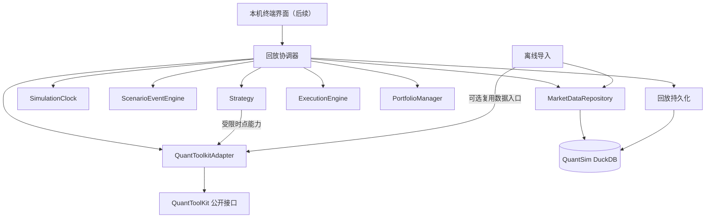

# QuantSim 架构

QuantSim 是运行在 macOS 本机的量化交易终端模拟器。第一条可运行链路用冻结行情和确定性回放验证从决策到成交、账本及绩效的全过程。QuantToolKit 作为独立的 Python 包，继续负责因子、统计、样本、模型和已有回测原语。审计基线和当前依赖版本见 [toolkit_integration.md](toolkit_integration.md)。

## 模块依赖

箭头指向调用方所依赖的接口。回放协调器只编排顺序和提交事务。各模块的业务输入与状态由协调器显式传递。

| 模块 | 职责与测试入口 |
| --- | --- |
| MarketDataRepository | 导入冻结批次，读取交易日历、可见历史和当前实际 bar。用小型 DuckDB 测试时点、缺行与价格口径 |
| SimulationClock | 按固定日历生成单调 tick，支持从最后已提交 tick 恢复。用含假期和提前收盘的日历测试 |
| ScenarioEventEngine | 选择在 tick 生效且已发布的场景事件，按固定序应用交易限制。用同一时间多事件和重放测试 |
| Strategy | 固定策略和动量轮换用只读可见行情、持仓股数和场景限制生成订单意图。动量轮换通过 Adapter 计算历史收益或动量与低波动合成分数，策略版本及参数随回放运行保存 |
| ExecutionEngine | 对待成交订单应用当期真实 bar、交易限制和资金约束，产生成交或结束原因。用零成交量和现金不足测试 |
| PortfolioManager | 根据已确认成交更新仓位及现金，以指定估值价生成日终快照。用手算资金和持仓变动测试 |
| Replay | 编排日频回放，在同一事务提交业务记录和检查点，并按指定序号重试或恢复 |
| QuantToolkitAdapter | 查询和调用工具箱能力，集中处理 pandas 转换、来源和异常。以真实 Toolkit 验证传入对象和来源路径 |

## 一次日频回放

初期限定单市场、单币种和无公司行动的固定测试区间。整数股、只做多，市场单以下一交易日收盘价为成交参考价。收盘生成的订单最早在下一 tick 成交。日频 close 回放假设成交于 bar 的逻辑收盘，输入必须在该 tick 可用。日历由冻结清单显式提供，行情缺行仍保留交易日。

1. 时钟读取下一交易日的 `session_date`、`market_close_at` 与 `cutoff_at`。行情按批次和 `available_at <= cutoff_at` 读取，场景事件先应用于该 tick。场景限制同时受生效时刻和发布时间约束，延迟发布的限制最早在可见 tick 应用。
2. 执行上一交易日留下的订单，固定排序并逐笔扣减本 tick 的可用现金、可卖股数和成交容量。采用真实、有效、有量且未被场景禁止成交的 bar。无合格 bar、资金不足或容量不足时到期，记录原因。初期每单全成或结束。
3. 组合以实际成交及费用过账。估值优先使用当期可用真实收盘价。暂缺价格时沿用最近可见的实际收盘价并标记 stale。持仓没有可追溯标记价时，该 tick 无法完成。合成行情可供研究计算，不进入撮合。
4. 策略看到收盘后的可见历史和最新快照，生成下一 tick 的意图。窗口不足返回空决策。新单无需预扣现金，提交时校验结构与可交易标的，实际购买力以成交步骤的余额为准。
5. 同一个 DuckDB 事务写入成交、现金流水、日终持仓、订单和 tick 检查点。提交成功后下一次读取才会进入下一 tick。失败保留上一提交点，从持久化记录恢复并用同一输入重试。最后一个 tick 只处理已有到期订单并结束回放。
6. `Replay.performance` 从初始权益及连续的已提交权益构造组合简单收益。等权基准只读相同冻结版本在各日 cutoff 可见的原始价格。Adapter 使用 QuantToolKit 公开入口计算指标及渲染事件回放图，因子远期收益和价差另由研究链路处理。

`market_close_at` 是经济时点，`cutoff_at` 是模拟器使用输入的最迟时间。实际可用性晚于 cutoff 的数据只能在后续视图中出现。订单目标是下一交易日的 close，即使后续才收到前一日 bar 也不会倒填成交。初期费用为显式配置的单次成交费用率，滑点为 0。固定成交容量系数和费用舍入规则写入运行配置，完整定义见 [api.md](api.md)。

## 可复现与范围

- 用数据版本和内容哈希锁定行情、日历、证券映射及场景。策略版本、参数、执行参数、随机种子、Toolkit SHA 和锁文件摘要随运行记录。以稳定顺序计算和分配 ID。重放比对业务记录，实际运行时间字段独立。
- 研究批次可以用复权价格、补齐面板和时点行业数据。撮合批次要求原始价格、有量或不可成交标记，以及明确无公司行动的区间。真实市场成分历史、拆并股、分红、借券、融资与多币种分别进入后续里程碑。
- 数据库是 QuantSim 单独的 DuckDB 文件。工具箱库可只读导入，任何联网刷新作为独立任务。核心模块采用 Python 3.12、uv、DuckDB 和现有 Toolkit；初期测试与离线回放从 Python 入口运行。界面依赖待回放链路稳定后选择。
- 日频回放已提供 Python 入口。对应表与后续执行顺序见 [database_schema.md](database_schema.md) 和 [implementation_plan.md](implementation_plan.md)。
