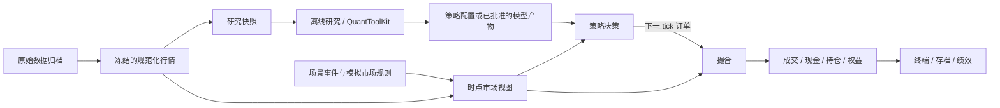

# QuantSim 开发流程说明书

**状态：设计草案 · 2026-11-07**

QuantSim 是一款在 macOS 本机运行的量化交易终端模拟游戏。玩家用历史行情研究因子、构建策略，再把策略带入逐日回放的模拟账户。每笔成交都可以追到订单、行情和费用，每次实验都可以用原始配置复查。历史挑战和基金经营在这条链路上加入虚构事件、容量和资金约束。

这份说明书用于安排里程碑、派发任务和验收可运行版本。当前技术约定见[架构](architecture.md)、[接口](api.md)和[数据库设计](database_schema.md)。[实施计划](implementation_plan.md)保留 M0–M5 的早期拆解及 M1、M2 的历史交付记录。

## 1. 从哪里开始

| 已有能力 | 当前证据 | 对下一阶段的影响 |
| --- | --- | --- |
| M0 源码审计和接口设计 | 有架构、接口草案及 [QuantToolKit 能力审计](toolkit_integration.md) | 开任务前复核将要调用的具体公开接口。查到能力与启用能力分开记录 |
| M1 Python 工程与最小接入 | Python 3.12、uv、DuckDB schema 和最小 Adapter。README 示例从收盘价 10 到 11 得到历史收益 0.1 | 沿用 Python 入口和 Adapter 的策略计算通道 |
| M2 历史市场基础 | 本地历史包、冻结数据版本、交易日历、证券身份、历史池、披露时点和字段来源。固定样本可以产生独立的价格冲击快照 | 复用 `MarketDataRepository`、`MarketView` 和合成 fixture 构建回放。真实市场覆盖及供应商口径随真实数据包验收 |
| 回放、策略与绩效 | 已实现日频撮合、账户账本、策略调仓及检查点恢复。可从已提交权益生成费后绩效、等权持有基准和报告 | M3、M4-01 和 M4-02 独立验收通过，下一项为 M4-03 运行记录 |

2026-11-08 独立验收覆盖 M0–M2 和 M3-01 至 M3-04，验收对象为 `7bbbe0e` 加当时的未提交改动，报告快照标识为 `a01634ae865b8b7b89d8f032446078b83b87a8ad`。该快照 76 项 pytest 通过，报告无阻断项。QuantToolKit 通过 `../quant/QuantToolKit` editable 安装，独立交付时需验证固定依赖来源和安装流程。

聊天稿从 M3 起采用了另一套编号。这里沿用项目的 M3 最小回放、M4 策略与绩效、M5 离线研究与终端演示，再安排 M6–M9。聊天稿中的终端先在 M5 接入，交易进阶放入 M6，事件、游戏进度与发行分别对应 M7、M8、M9。

## 2. 产品范围与设计决定

| 决定 | 本稿建议 | 确认时点 |
| --- | --- | --- |
| 市场与频率 | 开发用单市场、单币种、无公司行动的日频 fixture。真实数据目标为美股 S&P 500 历史成分，按当时已知的入池、退市和代码信息建立证券池 | M3 沿用 fixture。M6 接入真实交易场景前确认数据覆盖和公司行动口径 |
| 语言与界面 | 中文界面、英文代码与 API 名。终端默认深色，提供行情、研究、策略、组合、回放视图。行情表与图表联动，主要操作可通过键盘完成 | M5 用交互稿和本机演示验收 |
| 第一条交易规则 | 整数股、只做多、市价单在下一交易日收盘模拟成交。首版全成或结束、显式费率、固定容量、滑点为 0 | M3 以现有[接口约定](api.md)为准 |
| 工程路线 | 核心沿用 Python 3.12、uv、DuckDB 和 QuantToolKit。React + TypeScript + Vite、FastAPI、ECharts 和 Tauri 2 + Python sidecar 是候选方案 | M5 选定终端实现，并用最小本机包验证后端启动和退出。M9 再验收正式发行包 |
| 第一版玩法 | 本地自由研究和历史挑战。基金经营先验证一个由资金规模、容量和赎回约束组成的任务 | M8 确认首发场景和教程。成就、排行榜、完整场景编辑器按独立扩展验收 |
| 发布顺序 | Apple Silicon 本机发行包 → Steam 测试交付 → 正式上线。Intel Mac、Windows、分钟级和多市场另立任务 | M9 核对当时平台要求、支持范围和发布账号 |

任意玩家 Python 脚本、真实券商和真钱交易排除在本路线之外。多空策略可以在支持相应口径的研究回测中比较。允许空头订单之前，先交付借券、融资、保证金和空头账本规则。

## 3. 数据和回放如何连接

- **行情归档与时点读取。** 用稳定证券 ID 关联数据，用历史 ticker 展示。行情要满足 `bar_end_at <= cutoff_at` 与 `available_at <= cutoff_at`。披露和池成员各有可用时刻。原始成交价、研究复权价和场景派生价分别保留来源及用途。缺行、停牌、零量、退市与不可见记录各有明确状态。
- **研究与策略。** 研究入口可以使用未来标签、复权面板、统计检验和训练。策略入口只接收绑定当前 cutoff 的数据、允许的特征、已审核的配置或模型产物。实验中使用的目标权重可以保存为策略版本。进入回放后，由策略按持仓和规则生成订单。
- **策略与成交。** 策略决定买卖意图，撮合按当期可用行情和约束产生成交，账本用实际成交过账。历史研究回测的收益、事件回放的账户权益分别标注执行口径。
- **界面与状态。** 终端发出运行、暂停、单步、保存等命令，读取已经提交的快照。账户、时钟和实验状态由后端持有，断开界面后可从已提交状态恢复。

### 一个交易日的处理顺序

1. 读取下一交易日的收盘时刻及 cutoff，按固定顺序处理当期已发布且已生效的交易限制。
2. 处理先前订单。M3 对可交易且有量的原始当期 bar 使用收盘参考价，依次扣减容量、现金或可卖股数。无合格 bar 时记录订单结束原因。
3. 写入待提交的成交、费用、现金和持仓变动。按当期可见收盘价估值，缺价时用最近可追溯的可见价格并标记 `stale`。持仓没有可用标记价时，本 tick 失败并保留上一提交点。
4. 让策略读取当期可见数据和过账后的快照，生成最早下一交易日执行的订单。最后一日只处理到期订单并结束运行。
5. 在同一个 DuckDB 事务提交事件、订单、成交、流水、持仓、权益和检查点，提交成功后才推进时钟并更新界面。失败可以重试同一个 tick，成功提交后的重试返回既有结果或恢复已提交状态。

## 4. 里程碑路线

下表的版本表示交付能力。每一行都需要一个离线可运行入口或一份可安装构建。M0 交付的是可复核的审计与验证方案。

| 阶段 | 交付版本 | 依赖 | 阶段验收时看到什么 |
| --- | --- | --- | --- |
| M0 审计与架构 | 设计基线 | QuantToolKit 源码和测试 | 可以定位计划复用的接口、签名、输入形状、返回和来源契约 |
| M1 工程骨架与接入验证 | v0.1 基础 | M0 | 初始化空库、导入 fixture 并运行第一项 Toolkit 特征 |
| M2 历史市场 | v0.1 历史市场 | M1 | 指定日期、证券池和字段，得到按时点可见且有来源的快照 |
| M3 最小回放 | v0.2 回放 | M2 | 从空账户开始，跑完买入、卖出、净值和故障恢复 |
| M4 策略与绩效 | v0.3 策略回放 | M3 | 运行策略，查看有账本依据的绩效和实验配置 |
| M5 离线研究与终端 | v0.4 研究终端 | M4，界面原型可并行 | 在本机终端浏览行情、运行研究和回放，读到订单、净值及实验记录 |
| M6 策略工作台与交易进阶 | v0.5 模拟交易 | M5 | 保存策略版本，手动或按策略下单，对账并解释成交或拒绝原因 |
| M7 虚构事件与场景 | v0.6 历史挑战 | M6 | 运行可重放的新闻与冲击场景，核对其对模拟市场的影响 |
| M8 存档、挑战与基金管理 | v0.7 游戏测试版 | M7 | 从教程开始玩一局，保存并恢复，同一实验可以回看和比较 |
| M9 桌面封装与发行 | v1.0 macOS，随后 Steam | M8 及发布条件 | 新机器安装运行，完成离线游玩、退出恢复及一次升级验证 |

### M0–M2 建立并复查基础

- **M0 · 架构与接入审计。** 交付接口定位、输入形状、来源契约、错误行为和计划启用的入口。复核本机可编辑依赖与固定来源的区别，记录发布构建应当使用的依赖来源。
- **M1 · 环境与数据库。** 用空库初始化、重复初始化、批次重导入、失败回滚和 README 示例验收。当前开发启动方式见 [README](../README.md)。
- **M2 · 历史行情。** 用现有离线样本核对提前收盘、改码和代码复用、池成员、退市、停牌、迟到 bar、披露修订、原始价与复权价以及逐值来源。快照可归档复查，派生冲击只作用在模拟快照上。真实数据包的覆盖和质量进入独立验收。

### M3 最小回放

| 任务 | 预计涉及的模块 | 完成证据 |
| --- | --- | --- |
| M3-01 交易时钟 | 日历读取、Clock | 已实现。离线样本验证假期、提前收盘、最后一日和从提交序号恢复，见 [时钟验收测试](../tests/test_simulation_clock.py) |
| M3-02 交易限制与固定策略 | Scenario、Strategy、MarketView | 已实现。验证 halt / resume 的同刻顺序、迟到事件、固定策略对当前行情及持仓的依赖，以及更改未来 bar 后的决策一致性 |
| M3-03 撮合 | Execution、订单与成交 | 验收快照通过。下一 tick 执行，覆盖迟到、缺行、零量、停牌、容量不足、现金不足和可卖量不足。见 [撮合测试](../tests/test_execution.py) |
| M3-04 现金、持仓及估值 | Portfolio、流水与权益 | 验收快照通过。用 Decimal 和货币精度复算每笔流水与每日权益，覆盖空仓、清仓、费用和 stale 估值。见 [账本测试](../tests/test_portfolio.py) |
| M3-05 持久化与恢复 | 协调器、DuckDB、检查点 | 独立验收通过。接受意图时校验证券属于冻结版本。用撮合输出的已舍入成交过账，按非零股数核对持仓。提交前失败时整步回滚，提交后重试不重复过账，中断后继续得到相同业务记录 |
| M3-06 贯通演示 | 本地入口、fixture、README | 独立验收通过。[README](../README.md#运行三日回放) 提供离线命令。[回放测试](../tests/test_replay.py) 覆盖无成交和末日行为 |

**独立验收记录（2026-11-08）。** M3-05 与 M3-06 全部通过，无阻断项。验收对象为 `3871f2518b72773061ab8f27a703a906b4d174d3` 加当时的工作区改动。已跟踪改动的 diff SHA-256 为 `04c0d263b6146eb08a88fb5fe7037bb71ce9fbe8c5c90b2cd3cd21b26f83f599`。原始 `acceptance_report.md` 的 SHA-256 为 `83b2e0427a5af550ee6503f23f1ae4281ffda7800c3f9fc6a13934f7fb11747d`，其中列出了新增交付文件的摘要。

- 270 项独立断言通过，覆盖事务内故障、跨进程恢复、重复提交、迟到行情、单日区间与离线入口。正常三日回放的清仓权益为 1,009.77 USD。
- 独立验收使用已有开发环境，84 项 pytest 通过，Ruff 代码与格式检查通过。报告中的五条代码和文档建议归为非阻断项。
- 本机补验在现有开发环境运行 `uv sync --locked` 和常规 `uv run --locked` 检查，依赖同步成功，84 项 pytest 与 Ruff 检查通过，三日示例结果与报告一致。

**手算验收样例。** 使用三天的合成行情、初始现金 1,000、费率 10 bp，容量足够。第一天发出买入 10 股的订单。第二天收盘价 11，买入费用 0.11，现金 889.89、持仓市值 110、权益 999.89。第二天发出卖出 10 股的订单。第三天以 12 成交，卖出费用 0.12，清仓后现金和权益均为 1,009.77。同一用例在第二天提交前注入故障，恢复后核对两个成交及其对应流水。

### M4 策略与绩效

- **M4-01 策略特征与调仓。** 在 Adapter 中逐个启用动量、波动、合成分数和调仓所需能力，保存版本和参数。以直接调用 QuantToolKit 对照相同输入的结果。观察窗口不足、停牌和不可用数据有确定行为。
  - **首批动量调仓独立验收（2026-11-08）。** DeepSeek Harness 在一次性副本中复现 A–E，全部通过，无阻断项。验收对象为 `ab3c704` 加首批 M4 工作区改动，已跟踪差异 SHA-256 为 `45046053893a8b4e6f5cc82e7d4e9296c8f7e47abe4e8fde5cc5b31caa090a5c`，新增测试 SHA-256 为 `3988ae8c5bcd1bb55b69d1de17af172942a21b0453406a4b29911682702bede4`。报告 SHA-256 为 `7b8758e560851d69e0734deb14ade07cf1c43d333473f5c59b7fb57194b79716`。92 项 pytest 通过，六日回放权益为 189.61 USD，卖单因停牌结束而买单独立成交的用例为 389.72 USD，并从旧版源码创建的 M3 运行续跑至 1,009.77 USD。
  - **波动率与合成评分。** Adapter 使用连续可见的冻结日历收盘价计算历史波动率。配置 `volatility_window` 后，调仓使用等权的动量与低波动截面分数，保存版本 2 和窗口参数。已有纯动量运行沿用版本 1。参数及窗口不足的行为见 [Strategy](api.md#strategy)。
  - **波动率与合成评分独立验收（2026-11-08）。** 初次运行的报告超时，事件日志复现了数学同分受浮点舍入影响的误选。修复后，DeepSeek Harness 在新副本复验通过，无阻断项。98 项 pytest 及 Ruff 检查通过，波动率与 Toolkit 一致，迟到窗口返回缺失，合成策略版本 2 可恢复，同分按 UUID 决胜。验收对象为 `ab3c704` 加本轮工作区改动，五个业务文件的摘要见 [任务单](acceptance/AGENT.md)。报告 SHA-256 为 `7c181b44e451a77800c124896a54c6d925f957f0ef864330f3cd5e64ff501865`。
- **M4-02 基准与统计。** 从连续的账户权益生成日收益，接入等权持有基准、累计收益、夏普、最大回撤、胜率与回放报告。明确统计区间、费用、币种、基准缺行和样本不足处理。
  - **独立验收（2026-11-08）。** 验收对象为 `d384337` 加本轮工作区改动，业务文件摘要和 QuantToolKit 版本见 [任务单](acceptance/AGENT.md)。首次进入模型的会话完成 104 项回归及独立脚本，提交最终结论前超时。同一副本复跑脚本后通过，无阻断项。报告 SHA-256 为 `42cd39876e19d52e80658d4f713fa8f4270c153319765c821dd0c5562bdcadd8`。
  - **离线基线。** 三日策略费后累计收益 0.977%，等权持有基准 20.000%，成交费用 0.23 USD。另复现双证券固定份额基准、迟到与缺价、样本不足、报告重建及断档拒绝。本机从 `d384337` 源码创建的旧运行读出前两日统计并续跑，清仓权益为 1,009.77 USD。
- **M4-03 运行记录。** 持久化策略、数据版本、成交规则、种子、绩效和报告引用。重复执行相同配置，比较订单、成交、流水和权益业务值。报告生成失败后可从已提交数据重建。

### M5 离线研究与终端

- **M5-01 研究链路。** 先完成单因子选择、横截面排名、分组收益、IC / Rank IC、ICIR 和实验保存，再交付滚动统计、因子相关性、行业中性化与参数比较。候选因子包括 `mom_20d`、`mom_60d`、`mom_12m_minus_1m`、`vol_60d_res`、`sp_ratio`、`turn_20d`。逐项审计名称、数据要求和口径，UI 以 Adapter 已启用的能力为准。
- **M5-02 标签与模型。** 接入时间切分和离线 LightGBM 实验。按标签实际结束时间验收训练边界，验证预测特征列顺序、数据时点及模型版本。回放只允许通过验证的推理产物。
- **M5-03 本机终端。** 完成行情表、证券详情、K 线、研究工作台、策略、组合和回放结果。先用离线样本接通加载、空结果和错误状态，再用通过核验的历史包验证显示。按键盘走通行情到研究结果的主路径。
- **M5-04 运行方式。** 给出一条本机启动命令、一条检查命令和本地接口文档。做一次最小桌面封装验证，覆盖原生依赖、启动后端、应用退出和数据路径。终端退出后，可以继续读取已提交的回放和实验结果。

### M6 策略工作台与交易进阶

- **M6-01 策略构建。** 提供动量、反转和多因子模板。参数、横截面选择、权重、调仓频率、行业和风险约束存成策略版本。把版本化目标组合映射成受账户规则约束的订单。验收同一策略版本能在相同条件下重跑和比较。
- **M6-02 模拟账户。** 增加手动下单、限价及有效期，再增加明确的滑点和部分成交规则。日线限价单需要先明确触价、跳空、成交价、容量和过期的处理，再用同一批 bar 验证现金、持仓和未完成数量。卖出款可用时间单独记录，下一交易日执行时点沿用回放约定。
- **M6-03 真实数据。** 为用于交易的历史区间验收成分、退市、拆并股、分红、停牌及处置价格。支持的公司行动按规则进入现金和持仓账本。数据不足的区间标明覆盖范围，含未支持公司行动的区间停在交易验收前。
- **验收动作。** 从终端手动下单和运行一次策略调仓。逐单核对状态、成交、费用和风控原因，按日期复算每日权益及风险敞口。

### M7 虚构事件与场景

- **M7-01 事件与新闻。** 为每个事件记录来源、发布时间、生效时间、首个影响 tick、对象和版本。首批选择行业供应冲击、个股财报意外和市场流动性压力，分别验证行业、证券和市场三个范围。信息事件进入新闻，玩家按已知信息决策。直接冲击由场景规则改变派生价格、成交量或交易限制。
- **M7-02 市场影响。** 冻结种子、叠加顺序、持续与衰减规则。复用现有价格冲击派生能力。若场景需要用冲击后的价格撮合和估值，先审查这一执行口径，再通过独立场景配置启用。成交记录同时引用历史 bar 和事件规则版本。缺行、零量和禁止交易状态仍按相应场景约束处理。
- **M7-03 场景交付。** 先提供本地场景清单和可读校验结果。用同一数据、场景和种子重放两次，比较新闻可见顺序、派生价格、成交和权益。独立跑一次历史研究，检查结果与启用场景之前相同。

### M8 存档、挑战与基金管理

- **M8-01 存档与回放控制。** 支持新建、自动保存、暂停、单步、快进和恢复。存档记录最后提交 tick、数据、策略、执行和场景版本。恢复时检查引用是否可用。快进复用逐 tick 执行，暂停停在已提交边界。
- **M8-02 实验和模式。** 自由研究及实验室共用研究工作台。历史挑战从指定账户、时间段和约束启动。研究结果和游戏存档分别归属运行空间，可以通过显式选择导入一个策略版本。
- **M8-03 可玩任务。** 做一条可完整游玩的教程和基金任务。玩家研究一个信号、形成策略、运行一段回放，再面对一次事件和容量变化。资金规模、研究预算和赎回通过明确规则影响任务成绩，记录收益、回撤和约束完成度。
- **验收动作。** 创建两个存档，分别运行、退出、恢复并比较实验。将同一挑战逐步执行与快进的最终状态逐项对照，再用旧版存档验证升级和备份恢复。

### M9 桌面封装与发行

| 步骤 | 交付 | 放行条件 |
| --- | --- | --- |
| M9-01 发布候选 | Apple Silicon 独立安装包、示例数据、导入入口、第三方许可记录 | 在没有开发环境的 Mac 上离线安装并启动，完成一局挑战、恢复存档、打开研究结果和退出应用 |
| M9-02 发布回归 | 前后端端到端测试、长时回放、性能基线、数据库及存档升级、签名和公证验证 | 候选版本可安装，应用与后端可正常退出，导入失败可恢复。记录长时回放耗时、内存、查询与渲染结果 |
| M9-03 Steam 测试 | 测试构建、商店素材和当期平台清单 | 在 Steam 环境验证安装、启动、更新和存档恢复。每份随包数据有可审查的分发依据。依赖 Steamworks 的功能逐项选择和验证 |
| M9-04 正式上线 | 经批准的正式构建、发布说明及回滚方案 | 用户确认发布版本、渠道、素材及上线时间，发布后验证正式渠道的安装和启动 |

开发环境的数据包和安装包数据分别登记。安装包优先使用自制合成场景或已经核实分发条件的数据。真实数据也可通过用户本地导入进入 QuantSim。发行阶段为每份随包数据记录提供方、文件范围、版本及分发依据。

## 5. 每个任务怎么做

独立验收由另一名代理执行，启动指令、当前验收范围和报告要求见 [验收 AGENT.md](acceptance/AGENT.md)。

1. **派任务。** 选一个能独立验收的行为，记录编号、依赖、预计修改模块、可运行入口、验收数据和已知边界。规则有歧义时，把需要决定的交易行为写成具体例子。
2. **核对现状。** 读目标模块、测试、当前 schema 和对应文档。接入 Toolkit 时定位公开函数、签名、输入形状、来源要求和返回值。将拟新增的行为与已有行为对照。
3. **交付最小链路。** 按确认的范围实施，先用离线数据跑通新增行为。接口变更同步到对应文档，结构变更追加数据库迁移，用旧版本数据库及新库验证升级、数据保留、重复执行和失败回滚。
4. **提交验收证据。** 报告实际改动、运行命令及结果，给出可复现的操作步骤、示例输出和已知限制。需人工核验的项目保留待验收状态。
5. **阶段放行。** 运行本阶段演示和已有回归。记录交付物、构建版本、数据版本、执行口径和未完成项。由用户验收后再将依赖它的下一阶段移入开发，并记录对应的 Git 提交。

### 可直接复用的任务单

| 字段 | 填写内容 |
| --- | --- |
| 编号与目标 | 例如 M3-01。使用固定交易日历生成可恢复的日频 tick |
| 前置与参考 | M2 冻结版本、`SimulationClock` 约定、含假期和提前收盘的 fixture |
| 预期改动 | Clock 及其测试、必要的接口说明 |
| 验收操作 | 从头读取，与从上一已提交序号恢复分别得到同一后续序列。覆盖空区间、结束、重复读取及非法推进 |
| 范围边界 | 仅做日频时钟。撮合、界面和分钟行情各有独立任务 |
| 验收记录 | 命令、实际输出、已知限制、验收状态和关联提交 |

## 6. 贯穿各阶段的工程约束

- **来源和可复现性。** 实验与回放记录数据版本、cutoff、证券池、策略及场景版本、执行参数、种子、Toolkit 修订与锁文件摘要。若使用本机可编辑且有未提交改动的依赖，记录源码状态并标为本机实验。阶段发布用可独立安装的固定依赖和数据。
- **Toolkit 边界。** QuantSim 集中通过 Adapter 调用公开接口。对象需要来源时，经公开入口登记当前实际传入的对象。每个能力经契约检查与集成测试后才开放。需要改动上游时单独列出变更及原因，由用户确认。
- **资金和持久化。** 金额与账本价用 Decimal。订单状态、成交、流水、持仓、估值及检查点在同一提交边界生效。数据库结构变更通过版本迁移升级，保留旧数据并验证失败回滚；不支持的旧库需重新导入。关键日志保留运行、tick、订单和事件标识。
- **测试与文档。** 离线运行回归。每个里程碑验证正常路径和本阶段特有的失败路径。M1–M2 使用现有 pytest 和 Ruff，新增前端或类型检查时同步写入项目检查入口。页面、报告和任务记录中的结果以实际运行为准。
- **代理任务范围。** 编程代理按任务单操作。修改市场口径、扩大交易功能、更新核心依赖、改动 QuantToolKit、随包分发外部数据和对外发布，均有独立交付及确认记录。异常保留可定位的原因，失败在验收记录里有对应状态。
